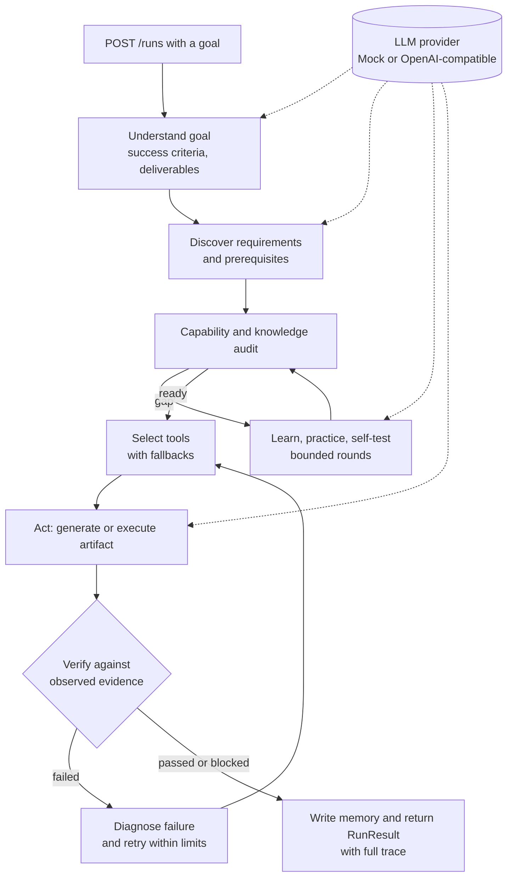

# Goal Agent Controller

**What it does:** you give it a goal over a REST API, and a controller loop breaks the goal into requirements, picks tools, produces an artifact and checks the result before reporting success.
**Tech:** Python, FastAPI, Pydantic, pytest, plus a pluggable LLM provider: a deterministic mock, or OpenAI and any OpenAI-compatible API such as OpenRouter.
**Run it:** `pip install -e '.[dev]' && ./demo.sh` (mock mode, no API keys). Or start `uvicorn` and open `http://127.0.0.1:8000/docs`.

Goal Agent Controller is a research prototype of a goal-driven agent loop. It explores how a system can turn a user's goal into a bounded, evidence-driven execution process.

## Architecture



The core idea: **the user provides the WHAT; the system determines the HOW.**

The controller discovers requirements and capabilities, audits knowledge, researches through a bounded browser, learns and practices, tests and transfers capabilities, selects tools, executes artifacts, verifies observed results, diagnoses failures, retries within limits, records memory, and generalizes experience.

## Setup

The Python package is still named `agi_prototype` (the project's earlier name). Renaming it would touch every import, so I left it as is.


```bash
python -m venv .venv
source .venv/bin/activate
pip install -e '.[dev]'
pytest
uvicorn agi_prototype.api:app --reload
```

Open `http://127.0.0.1:8000/docs` in a browser. This is FastAPI's Swagger UI, so you can try `POST /runs` there without curl. The other endpoints are `GET /health` and `GET /memory`.

## Demo

Everything below runs in mock mode, so you do not need any API keys. `MockProvider` is used whenever `OPENAI_API_KEY` is not set.

### Run it in mock mode

```bash
python -m venv .venv
source .venv/bin/activate
pip install -e '.[dev]'
unset OPENAI_API_KEY
uvicorn agi_prototype.api:app --port 8000
```

In a second terminal, or open `http://127.0.0.1:8000/docs`, expand `POST /runs`, click "Try it out" and paste the JSON body:

```bash
curl -s localhost:8000/health
curl -s -X POST localhost:8000/runs \
  -H 'Content-Type: application/json' \
  -d '{"goal": "Write a short study plan for learning SQL joins", "max_learning_rounds": 2}'
```

The full `/runs` response is about 8 KB of JSON (requirements, audit, learning, self-tests, trace and more). `GET /memory` shows what the run wrote to memory.

### One-command demo

`demo.sh` starts the server, sends one goal and prints a shortened version of the response:

```bash
./demo.sh                                   # default goal
./demo.sh "Write a checklist for a code review"   # your own goal
```

### Sample output (captured from a real local run, mock mode)

```text
$ curl -s localhost:8000/health
{"status":"ok","provider":"local-rule-provider"}

$ curl -s -X POST localhost:8000/runs -d '{"goal": "Write a short study plan for learning SQL joins"}'
{
  "status": "executed",
  "state": "COMPLETED",
  "requirements": [
    "learning_objective",
    "practice_and_assessment"
  ],
  "selected_tools": [
    "artifact_writer",
    "evidence_collector"
  ],
  "artifact_type": "study_plan",
  "verification": {
    "score": 100.0,
    "passed": true
  },
  "failures": [],
  "trace_steps": 35
}

--- artifact ---
# Python Learning Plan

Goal: Write a short study plan for learning SQL joins

1. Week 1: fundamentals and exercises.
2. Week 2: functions, modules, and errors.
3. Week 3: files and testing.
4. Week 4: capstone and transfer assessment.

Evidence plan: practice tasks, tests, and review of weaknesses.
```

Note: the mock provider uses fixed templates. That is why the artifact heading says "Python Learning Plan" even though the goal is about SQL. The point of the demo is the control loop (requirements, then audit, learning, self-test, execution and verification), not the quality of the generated text. Pointing it at the OpenAI provider gives real model output.

### Recording a GIF

Option A, [vhs](https://github.com/charmbracelet/vhs). Save this as `demo.tape` and run `vhs demo.tape`:

```text
Output demo.gif
Set FontSize 16
Set Width 1100
Set Height 700
Type "./demo.sh"
Enter
Sleep 4s
```

Option B, asciinema plus agg:

```bash
asciinema rec demo.cast -c ./demo.sh
agg demo.cast demo.gif
```

## Providers

The default `MockProvider` is deterministic and needs no credentials. Setting `OPENAI_API_KEY` switches to the OpenAI adapter. `OPENAI_MODEL` (default `gpt-4o-mini`) and `OPENAI_BASE_URL` (default `https://api.openai.com/v1`) are optional. Credentials are read from environment variables and are not stored in the repository.

Any OpenAI-compatible chat completions endpoint works through `OPENAI_BASE_URL`, for example OpenRouter:

```bash
export OPENAI_API_KEY=<your OpenRouter key>
export OPENAI_BASE_URL=https://openrouter.ai/api/v1
export OPENAI_MODEL=openai/gpt-4o-mini
uvicorn agi_prototype.api:app --reload
```

The adapter sends `response_format: json_object`, so the model has to support JSON mode. `GET /health` currently always reports `local-rule-provider`, even when the OpenAI adapter is active (see "what I'd improve").

## Verification

The verified baseline is **72 tests passing**: the original 68, plus 4 tests for the configurable base URL. Missing data, permissions, credentials, tools, or external services produce blocked or unavailable states. Generated text, a zero exit code, or model confidence alone is not considered proof of real-world success.

## Design decisions / what I'd improve

Design decisions:
- **Mock provider by default.** The whole loop runs offline and deterministically, so the tests don't depend on an API key, the network or model randomness. The LLM is behind a small `LLMProvider` protocol (understand, discover, assess, learn, test, generate_artifact), so swapping providers doesn't touch the controller.
- **Verification is separate from generation.** A run only counts as successful when the verifier checks observed evidence, for example that the artifact type matches what was asked. Model output or a zero exit code is not enough. A missing tool, key or permission ends in a `blocked` or `unavailable` state instead of a fake success.
- **Everything is bounded.** Learning rounds (`max_learning_rounds`, at most 20), retries and browser access all have hard limits, so a run can't loop forever.
- **Full trace in the response.** Every `/runs` response includes the step trace, failures and attempt history, which makes debugging and demos easier.
- **Plain `urllib` for the OpenAI call.** It avoids an SDK dependency and makes it easy to point at any OpenAI-compatible URL.

What I'd improve next:
- Use the model's native tool or function calling. Right now tools are picked from a registry by rules, not by the LLM.
- Make `/health` report the provider that is actually active, and add timeouts, retries and better error messages around the HTTP call.
- Persist memory (SQLite or Postgres). It is in-process right now and resets when the server restarts.
- Run goals asynchronously (background tasks plus a `GET /runs/{id}`) and stream progress, since real LLM runs can take a while.
- Make the mock outputs depend on the goal. The templates are fixed, which is why the demo artifact looks generic.
- Build a small evaluation set of goals with expected outcomes to compare providers and prompts.

## Limitations

This is a prototype, not a general intelligence system. Model reasoning remains a limitation. Browser access is bounded and primarily read-only; authenticated services and cloud deployment require configured connectors. Memory is lightweight, long-horizon autonomy is limited, evaluator independence is incomplete, and real-world grounding remains an open research problem.

